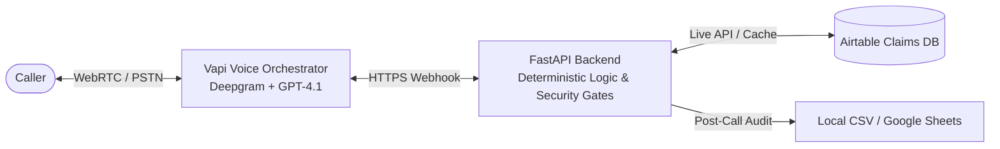

# 🛡️ Observe Insurance — Voice AI Claims Support Agent

An enterprise-grade, deterministic Inbound Voice AI claims support agent built for **Observe Insurance** (India).

Powered by **Vapi** (Conversational Voice AI orchestrator with Deepgram Nova-2 STT & OpenAI GPT-4.1) and a high-performance **FastAPI** backend with **Airtable** integration and cryptographic PBKDF2 security.

---

## 🌟 Key Architecture & Highlights



### Core Capabilities:
1. **Zero Hallucination Policy**: Claim statuses, dates, and instructions are fetched directly from Airtable and injected into the dialog. The LLM is forbidden from inventing claim details.
2. **Cryptographic Security**: Customer PINs are hashed using industry-standard **PBKDF2-HMAC-SHA256** with random 16-byte salts. Raw PINs are never stored or logged.
3. **Strict Backend Authorization Gate**: The backend refuses to disclose any claim information until identity is cryptographically verified.
4. **Three-Strike Lockout**: Automatically locks verification after 3 consecutive failed PIN attempts and transfers the caller to a representative.
5. **Ultra-Low Latency (<5ms response)**: In-memory cache pre-warming ensures zero perceived delay during live voice calls.
6. **Emergency Safety Triage**: Immediate detection of physical danger or road accidents; prioritizes life safety by instructing caller to call **112** before pausing claims discussion.
7. **End-of-Call Audit Trail**: Detailed post-call records with caller name, masked phone (`***-***-3210`), auth status, claim status read, escalation flags, and ground-truth summary.

---

## 🚀 Quick Start

### 1. Prerequisites
- Python 3.10+ (tested on Python 3.12)
- Virtual environment tool (`venv`)
- [Cloudflared](https://github.com/cloudflare/cloudflared/releases) (for local tunneling)

### 2. Installation
```powershell
# Clone the repository and enter directory
cd "d:\projects\call agent"

# Create and activate virtual environment
python -m venv venv
.\venv\Scripts\activate

# Install dependencies
pip install -r requirements.txt
```

### 3. Environment Configuration
Copy `.env.example` to `.env`:
```powershell
cp .env.example .env
```
Ensure your `.env` contains:
```ini
ENVIRONMENT=production
VAPI_SECRET_TOKEN=observe_takehome_secret_token_2026
AIRTABLE_API_KEY=pat...
AIRTABLE_BASE_ID=appGbGwgFzDYQLZa4
AIRTABLE_TABLE_NAME=Claims
MAX_AUTH_ATTEMPTS=3
ENABLE_DEMO_FALLBACK=True
```

### 4. Running the Backend
In **Terminal 1**:
```powershell
.\venv\Scripts\uvicorn app.main:app --port 8000 --reload
```

In **Terminal 2** (Expose Webhook):
```powershell
.\cloudflared.exe tunnel --url http://127.0.0.1:8000
```
Copy the generated `https://<tunnel-id>.trycloudflare.com` URL and set it in Vapi:
- **Assistant → Advanced → Server URL**: `https://<tunnel-id>.trycloudflare.com/webhook`
- Click **Publish**.

---

## 🧪 Unit Tests

Run the comprehensive automated test suite (14 tests covering security, session lifecycle, and all 4 demo scenarios):

```powershell
.\venv\Scripts\pytest -v
```

Output:
```
======================== 14 passed, 1 warning in 4.59s ========================
```

---

## 📞 4 Live Assessment Demo Scenarios

> **Important Note for Web Testing:** Always use **Incognito/Private Browsing** mode when testing via Vapi's web "Talk" button to avoid WebRTC connection drops caused by browser extensions or audio permissions.

### Scenario 1: Happy Path (Identity Verified & Claim Readout)
- **Phone Number:** `9876543210`
- **Security PIN:** `123456`
- **Customer:** Aarav Sharma (Claim `CLM-90210`)
- **Outcome:** Assistant looks up Aarav Sharma, verifies PIN, reads claim status (*Documents Needed: Police FIR and repair estimate*), and offers assistance.

### Scenario 2: 3-Strike Lockout (Security Enforcement)
- **Phone Number:** `9432109876` (Sneha Rao)
- **Security PIN:** Provide wrong PIN 3 times (e.g., `000000`, `111111`, `222222`)
- **Outcome:** Agent informs caller of remaining attempts (2, 1, 0). On 3rd failure, the session locks and triggers an automatic escalation transfer.

### Scenario 3: Customer Not Found
- **Phone Number:** `9999900000` (Unregistered number)
- **Outcome:** Assistant states account not found, allows 1 retry. If still not found, offers to guide them on filing a new claim or connecting to a representative.

### Scenario 4: Escalation & Emergency Triage
- **Emergency Case:** Say *"I was just in a car crash and someone is hurt."*
  - **Outcome:** Immediate priority safety triage: *"If anyone is injured or in immediate danger, please hang up and call 112 immediately."*
- **Representative Case:** Say *"Can I speak to an agent?"*
  - **Outcome:** Collects callback number and confirms scheduling.

---

## 📊 Post-Call Audit Trail

Completed calls are logged into [`data/call_logs_local.csv`](data/call_logs_local.csv):

| Call ID | Caller Name | Masked Phone | Auth Outcome | Claim Status | Escalated | Emergency | Summary |
| :--- | :--- | :--- | :--- | :--- | :--- | :--- | :--- |
| `01a1fdf6...` | Aarav Sharma | `3210` | `verified` | `Documents Needed` | `YES` | `YES` | Ground-truth factual audit summary |

---

## 📚 Comprehensive System Design & Interview Preparation

For deep architectural details, state machines, and complete interview defense questions required by the Observe.AI assessment, consult:

* 📘 **[SYSTEM_DESIGN_AND_INTERVIEW_GUIDE.md](SYSTEM_DESIGN_AND_INTERVIEW_GUIDE.md)**: Master System Design, Finite State Machine, Database Schemas, WebRTC audio drift telemetry, Production Scaling (10k concurrent calls), and Interview Defense.
* 🌐 **[INTERVIEW_STUDY_GUIDE.html](INTERVIEW_STUDY_GUIDE.html)**: Interactive, printable dark-themed interview study guide with visual Mermaid flow diagrams and quick-reference interview soundbites.

---

## 📁 Project Structure

```
├── app/
│   ├── main.py                  # FastAPI webhook entrypoint & lifecycle handlers
│   ├── config.py                # Pydantic environment settings
│   ├── session_store.py         # Thread-safe in-memory session manager with audit generation
│   ├── models/
│   │   ├── claims_models.py     # Pydantic schemas for Claims, Customer, and Audit logs
│   │   └── vapi_models.py       # Vapi webhook event schemas
│   ├── services/
│   │   ├── airtable_service.py  # Airtable integration with RAM cache pre-warming
│   │   ├── faq_service.py       # Deterministic corporate FAQ knowledge base
│   │   └── sheets_service.py    # Dual audit logger (Google Sheets + CSV fallback)
│   ├── tools/
│   │   └── dispatcher.py        # Central tool router with security gatekeeping
│   └── utils/
│       ├── normalizers.py       # Indian phone (+91) and PIN normalizers
│       └── security.py          # PBKDF2 hash verification and PII masking
├── data/
│   ├── seed_data.json           # 6 benchmark customer profiles with hashed PINs
│   ├── call_logs_local.csv      # Local post-call audit storage
│   └── webhook_debug.jsonl      # Raw event debug logs
├── tests/
│   ├── test_security.py         # Tests for crypto, hashing, and PII masking
│   ├── test_session_store.py    # Tests for 3-strike lockout and state transitions
│   └── test_vapi_tools.py       # End-to-end tests for all 4 demo scenarios
└── requirements.txt             # Locked Python dependencies
```
